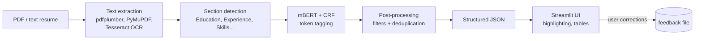

# Resume NER – Entity Extraction from CVs with BERT + CRF

[](https://github.com/Mohamed-jarboui/resume-ner-bert/actions/workflows/tests.yml)


Extracts structured information from resumes (PDF or text, English and French): **names, emails, locations, dates, degrees, skills and job experience**. A fine-tuned multilingual BERT with a CRF layer tags each token; rule-based post-processing cleans the output into JSON. It comes with a PDF pipeline (including OCR for scanned files), a Streamlit interface and a feedback loop for corrections.

Built as an NLP course project at École Polytechnique de Sousse.

## How it works



**Entities (BIO tagging, 15 labels):**

| Entity | Examples |
|---|---|
| `NAME` | Sarah Johnson |
| `EMAIL` | s.johnson@gmail.com |
| `LOCATION` | Paris, France |
| `DATE` | 2020 - 2024 |
| `DEGREE` | Master of Science in Data Science, MIT |
| `SKILL` | Python, Docker, Power BI |
| `EXPERIENCE` | Data Scientist, Google |

## Model

- **Encoder:** `bert-base-multilingual-cased`, chosen so that French and English resumes work with one model
- **Head:** linear projection to tag emissions + **CRF layer** (`pytorch-crf`), which learns valid tag transitions (e.g. `I-SKILL` cannot follow `B-DEGREE`)
- **Subword alignment:** only the first subword of each word carries the label; the rest are ignored in the loss
- **Training:** AdamW, learning rate 5e-5, batch size 16, linear warmup, up to 10 epochs with early stopping on validation F1 (patience 3); runs tracked with MLflow
- **Metrics:** entity-level precision, recall and F1 with `seqeval` (strict IOB2: an entity counts only if both its boundaries and type are right)

## Data

There is no public annotated resume dataset in French and English, so the training data is **generated**:

- A template-based generator (`src/data_generation/`) combines resume sentence patterns in English and French (headers, education, experience, skills lists) with lists of names, schools, companies, roles and skills. Tags are produced automatically, so the labels are exact.
- Config: 10,000 sentences split 80/10/10 into train, validation and test.
- **Hard cases:** 5 hand-annotated real-style resume snippets (`data/raw/manual_examples.json`) are oversampled ×200 and merged into the training set (`scripts/merge_dataset.py`), giving about 9,000 training sentences.

## Results

Entity-level scores (seqeval, strict IOB2) of the trained BERT+CRF model on 1,000 freshly generated test sentences (seed 2026, 984 unique), computed by `scripts/evaluate.py` in the [Evaluate model](.github/workflows/evaluate.yml) workflow:

| Entity | Precision | Recall | F1 | Support |
|---|---|---|---|---|
| SKILL | 1.000 | 1.000 | 1.000 | 759 |
| EXPERIENCE | 1.000 | 1.000 | 1.000 | 570 |
| DEGREE | 0.975 | 0.973 | 0.974 | 407 |
| DATE | 1.000 | 1.000 | 1.000 | 310 |
| LOCATION | 0.996 | 1.000 | 0.998 | 224 |
| NAME | 1.000 | 1.000 | 1.000 | 194 |
| EMAIL | 1.000 | 1.000 | 1.000 | 194 |
| **Overall** | **0.996** | **0.996** | **0.996** | |

**How to read this:** the test sentences come from the same templates and word lists as the training data, so a near-perfect score shows the model has learned those patterns, not that it reaches this level on real resumes. The only notable errors are on `DEGREE`, where school names and degree titles are sometimes split differently. A hand-annotated set of real resumes would be the honest next benchmark.

Reproduce with `python scripts/evaluate.py` (writes `results/test_metrics.json`), or pass `--data path/to/file.json` to evaluate on your own annotated data.

## Project structure

```
├── app/streamlit_app.py          # web interface
├── src/
│   ├── data_generation/          # templates, generator, augmentation
│   ├── preprocessing/            # tokenizer + label alignment, dataset, section detection
│   ├── models/                   # BERT, BERT+CRF (and a BiLSTM baseline architecture)
│   ├── training/                 # training config and loop (early stopping, MLflow)
│   ├── evaluation/               # seqeval metrics, error analysis
│   └── inference/                # predictor, PDF parsing, post-processing, visualization
├── scripts/
│   ├── generate_dataset.py       # create train/val/test data
│   ├── merge_dataset.py          # add oversampled hard cases
│   ├── train_bert.py             # train BERT or BERT+CRF
│   ├── evaluate.py               # entity-level evaluation
│   ├── process_pdf.py            # batch PDF extraction (JSON, CSV, TXT, HTML)
│   ├── smoke_test_model.py       # quick prediction check on a sample resume
│   └── inspect_hard_cases.py     # print predictions on the hard cases
├── models/checkpoints/bert_crf/  # trained weights (Git LFS) + label mappings
├── data/raw/manual_examples.json # hand-annotated hard cases
├── tests/                        # unit tests (no model weights needed)
├── docs/                         # setup and PDF processing guides
└── config.yaml                   # labels, paths, dataset settings
```

## Getting started

```bash
git clone https://github.com/Mohamed-jarboui/resume-ner-bert.git
cd resume-ner-bert
git lfs install && git lfs pull      # downloads the trained model (~700 MB)

python -m venv venv
source venv/bin/activate             # Windows: venv\Scripts\activate
pip install -r requirements.txt
```

For scanned PDFs, install Tesseract OCR (see [docs/setup.md](docs/setup.md)).

**Run the web app**

```bash
streamlit run app/streamlit_app.py
```

**Process PDFs from the command line**

```bash
python scripts/process_pdf.py resume.pdf --output results
python scripts/process_pdf.py resumes/ --batch --ocr
```

**Use it from Python**

```python
from src.inference.predictor import ResumeNERPredictor

predictor = ResumeNERPredictor(
    model_path="models/checkpoints/bert_crf/best_model.pt",
    label_mappings_path="models/checkpoints/bert_crf/label_mappings.json",
)
print(predictor.get_structured_json("Sarah Johnson | Paris, France\nData Scientist at Google (2021-2024)\nSkills: Python, SQL"))
```

**Retrain from scratch**

```bash
python scripts/generate_dataset.py
python scripts/merge_dataset.py
python scripts/train_bert.py --use_crf --train_data train_hybrid.json
mlflow ui    # view runs at http://localhost:5000
```

**Run the tests**

```bash
pip install -r requirements-dev.txt
pytest tests -v
```

## Limitations and next steps

- Trained on synthetic sentences; real resumes have more varied layouts and wording. The next step is to annotate a set of real resumes for training and an honest test set.
- Each model call reads at most 128 tokens. The section mode of the app runs the model per section, but whole-text mode and the PDF command line tag only the start of long resumes. Sliding-window inference would fix this.
- Corrections collected through the UI are saved but not yet used for automatic retraining.
- Serve the model behind a REST API (FastAPI) and containerize it.
